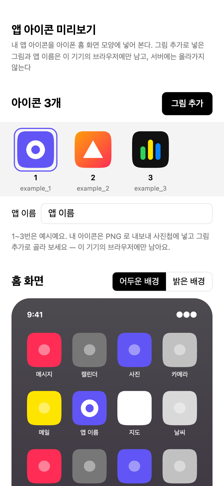
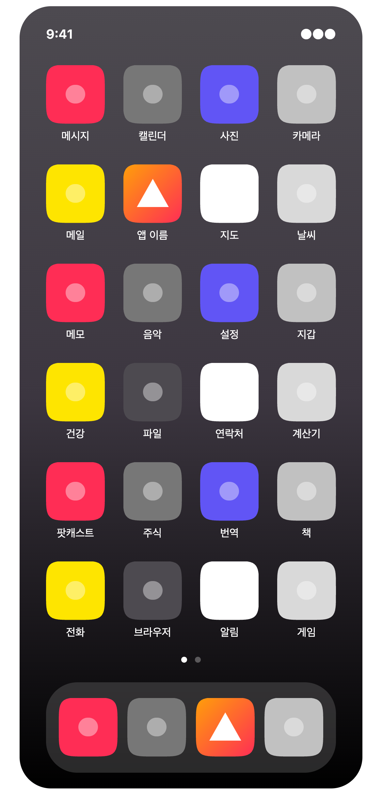
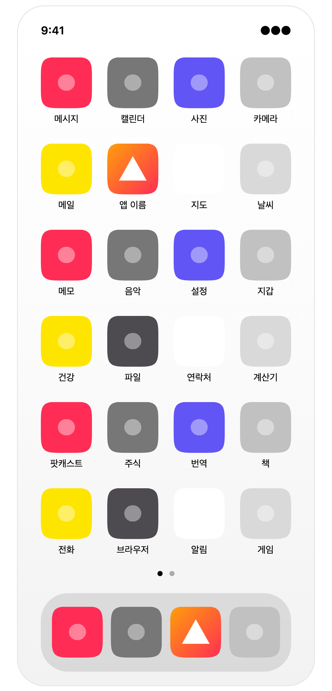
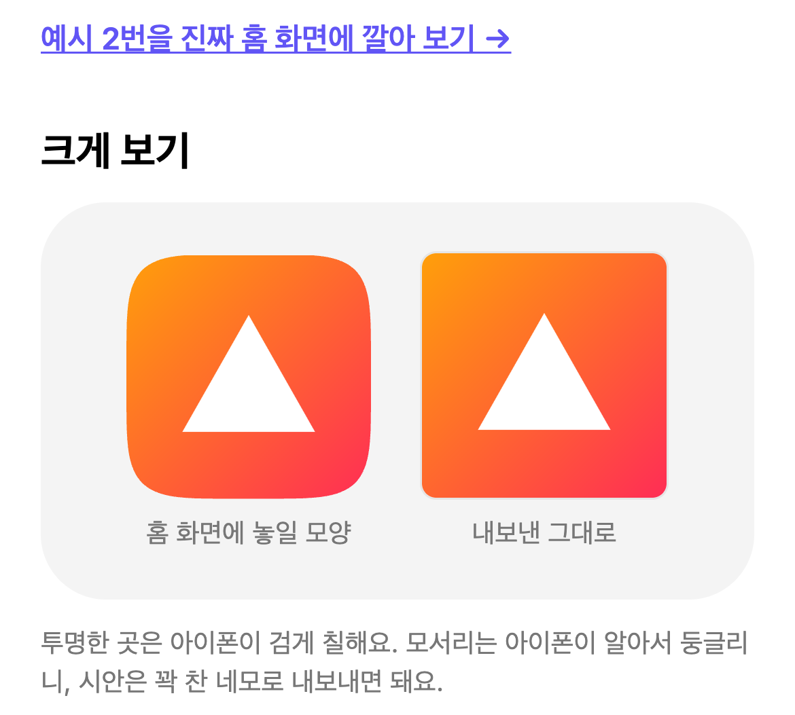

# 앱 아이콘 미리보기

앱 아이콘을 실제 iPhone 홈 화면에 놓아 보며 디자인을 확인하는 미리보기 도구.

<!-- 바로 써 보기: (예시 사이트 주소 — 배포 뒤 넣음) -->

## 쓰는 법

1. **폰에서 연다** — 이 도구를 띄운 주소를 아이폰 사파리에서 연다 (띄우는 법은 아래 "직접 띄우는 법")
2. **그림 추가** — 내 아이콘을 PNG 로 내보내 사진첩에 넣고, **그림 추가** 를 눌러 고른다. 여러 장을 한 번에 넣어도 된다
   - 처음에 보이는 1~3번은 예시 아이콘이다
   - **앱 이름** 칸에 적은 글자가 홈 화면에서 아이콘 밑에 붙는다

   

3. **홈 화면 미리보기** — 위쪽 아이콘 줄에서 하나를 누르면 아래 가짜 홈 화면에 들어간다. 어두운/밝은 배경을 둘 다 본다. 아래 **크게 보기** 에서 모서리가 잘린 모양과 원본을 나란히 본다

    

   

4. **진짜 홈 화면에 깔아 보기** — 예시 아이콘은 **"예시 N번을 진짜 홈 화면에 깔아 보기 →"** 를 눌러, 사파리 공유 → 홈 화면에 추가 하면 진짜 아이콘으로 깔린다. 다 봤으면 길게 눌러 지운다
   - 내가 넣은 그림도 같은 버튼이 있지만 **시험 중** 이다. 아래 "내 그림 깔아 보기" 를 먼저 읽어 주세요

   

## 내 그림은 내 기기에만 남는다

- 그림 추가로 넣은 그림과 앱 이름은 **그 기기의 그 브라우저 저장소(localStorage)에만** 남는다. 서버로 보내지 않고, 다른 사람에게 보이지 않는다
- 그래서 다른 폰이나 다른 브라우저에서 열면 보이지 않는다. 사파리에서 방문 기록·웹사이트 데이터를 지우면 함께 지워진다
- 저장소에는 누구의 시안도 넣지 않는다. `examples/` 에는 도형 몇 개로 만든 예시만 있다. 이 저장소를 가져다 직접 띄울 때도, 남에게 보이면 안 되는 그림을 `examples/` 에 넣지 않는다 — 띄운 주소를 아는 누구나 볼 수 있다

## 내 그림 깔아 보기 (시험 중, 아직 확인 못 함)

아이폰은 "홈 화면에 추가" 할 때 페이지의 `apple-touch-icon` 을 아이콘으로 쓰는데, 보통은 **서버에 있는 그림 파일의 주소** 를 읽는다. 내가 넣은 그림은 서버에 없고 기기 안에만 있어서, 설치 페이지(`install/mine/`)가 기기 저장소에서 그림을 꺼내 `data:` 주소로 아이콘을 단다.

**아이폰 사파리가 이 방식을 받아 주는지는 실제 아이폰에서 아직 확인하지 못했다.** 받아 주지 않으면 아이콘 대신 페이지를 찍은 모양이 깔린다. 확실하게 되는 것은 **예시 아이콘 깔아 보기** 뿐이다. 확인되면 이 칸을 고친다.

## 아이폰이 하는 일을 똑같이 한다

- 모서리를 **둥근 네모(스쿼클)** 로 잘라낸다 — 아이콘은 모서리를 둥글리지 말고 꽉 찬 네모로 내보내면 된다
- 그림의 **투명한 곳은 검게** 칠한다
- 정사각형이 아닌 그림은 가운데를 잘라 넣는다

## 직접 띄우는 법 (원하는 사람만)

[Node.js](https://nodejs.org) 가 필요하다.

```bash
npm install       # 예시 아이콘을 PNG 로 바꾸는 도구(sharp)를 받는다. 처음 한 번
npm run build     # examples/ → dist/
npm start         # dist/ 를 http://localhost:3000 에 띄운다
```

- 같은 와이파이의 폰에서 보려면 컴퓨터의 내부 IP 로 연다 (예: `http://192.168.0.10:3000`)
- `vercel.json` 이 들어 있어서 Vercel 에 올리면 `npm run build` 를 돌리고 `dist/` 를 내보낸다. 다른 정적 호스팅도 같은 두 가지만 설정하면 된다

## 파일

| 파일 | 하는 일 |
| --- | --- |
| `examples/` | 예시 아이콘 (SVG). 처음 보는 사람용 |
| `build.mjs` | 예시를 512px PNG 로 바꾸고, 미리보기 페이지와 설치 페이지를 `dist/` 에 만든다 |
| `src/index.html` | 미리보기 페이지. 그림 추가·앱 이름은 여기서 기기 저장소에 넣는다 |
| `src/install.html` | 예시 아이콘마다의 설치 페이지 틀. 아이폰은 그 페이지의 `apple-touch-icon` 을 쓰기 때문에 아이콘마다 페이지가 하나씩 필요하다 |
| `src/install-mine.html` | 내 그림용 설치 페이지 (시험 중) |
| `serve.mjs` | `dist/` 를 띄우는 작은 서버. 따로 설치할 것 없음 |
| `vercel.json` | Vercel 배포 설정 |

## 라이선스

코드는 MIT. [LICENSE](LICENSE) 참고. 예시 아이콘도 같은 조건으로 써도 된다.

만든 사람: Dangnee(당니) · [github.com/dangnuie-web](https://github.com/dangnuie-web) · dangnuie@gmail.com
